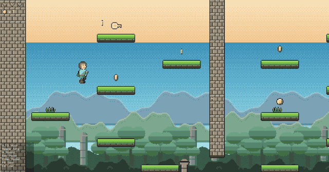
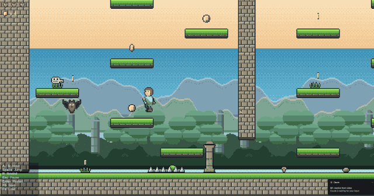
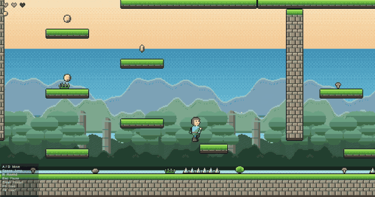
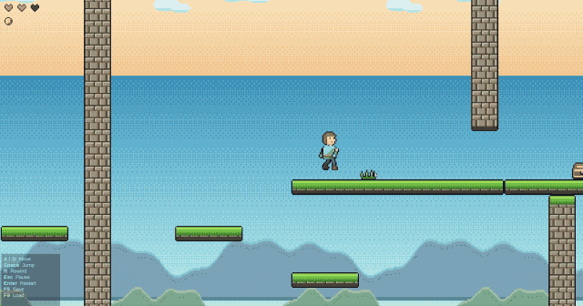

# 2D Platformer Template

A Unity 6 platformer sample built with C#, featuring character movement, time rewind, collectibles, and save/load. It uses a 16-bit pixel-art style and serves as a starting point for further gameplay development.

---

## Code to Explore

- [TimeRewind](Template%202D%20Platformer/Assets/Scripts/Systems/TimeRewind.cs): Uses a bounded circular buffer and reusable snapshot containers to record player motion and rewindable objects. Start with `Record` and `StepBack` to follow the rewind flow without shifting history entries.
- [PlayerController](Template%202D%20Platformer/Assets/Scripts/Core/PlayerController.cs): Separates input collection from physics updates and implements buffered jumps, coyote time, and a configurable ground probe.

## Showcase

**Movement and pickups** 

**Rewind** 

**Parallax** six background layers.

**Level complete** 

## Features

### Player Controller
- Responsive horizontal movement
- Jump buffering (coyote time)
- Smooth camera follow

### Rewind System
- Rewind of player and world state
- Works on: player, enemies, keys, doors, health
- Event-driven system with `IRewindable` interface
- Circular history storage with reused frames and snapshot lists after warm-up
- Existing object snapshots remain compatible; individual `SaveState` implementations may still allocate or box values

### Keys & Doors
- Collect unique keys (`KeyID`-based)
- Doors auto-unlock when player has required keys
- Event-driven unlocking

### Health & UI
- Heart-based health display
- Game Over screen when health reaches 0
- Damage on enemy contact and on spikes
- Enemies vanish after landing a hit

### Coins
- Spinning pickups with a HUD counter
- Kept on rewind

### Audio
- Nine chiptune effects, synthesised as WAVs in-project
- Single pooled `SfxPlayer` using `PlayOneShot`

### Pause & Restart
- `Esc` pauses, `Enter` restarts the level
- Game over pauses automatically
- Rewinding back above 0 health clears it

### Rewind Visuals
- Full-screen VHS effect while rewinding
- Custom Built-in RP image effect, no extra packages

### Save System
- JSON save/load of keys, coins and elapsed time
- `F5` saves, `F9` loads

### Input
- All bindings held in one `InputBindings` asset
- On-screen controls panel is generated from it

### Tested
- 33 EditMode tests: inventory, wallet, health, save round-trip, rewind history, snapshot restoration, and recorder allocations
- The warmed recorder allocates no managed memory across 1,000 recordings with preallocated test states. This isolates container reuse; it does not measure allocations inside gameplay objects or claim a frame-rate improvement.

### Puzzle Level
- `PuzzleLevel.unity`: four keys, three doors, one valid order
- Final door needs a key from each wing

---

## What It Demonstrates

The project demonstrates:
- Physics-based movement
- 2D raycasting and collision
- Event-driven game logic
- Rewindable state management
- Modular architecture and serialization

