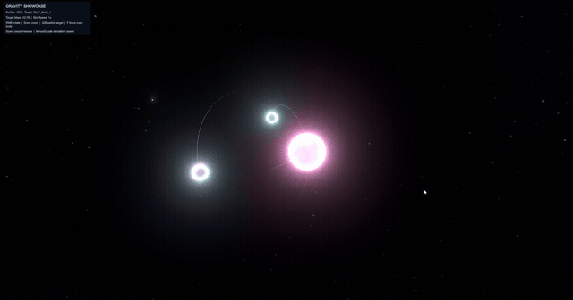
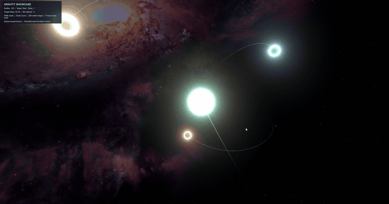
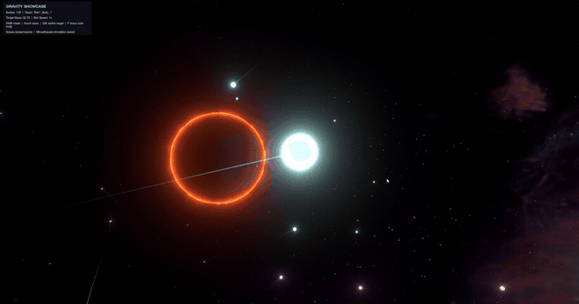
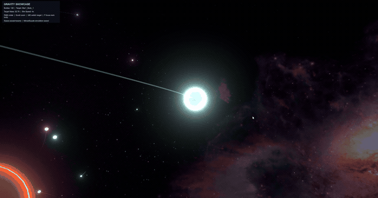

# Gravity

A 3D gravity simulation built in Unity 6 with C#. It explores orbital motion and interactions between bodies using the Barnes-Hut algorithm. Generated systems, orbital trails, and camera controls make it possible to follow individual bodies or observe the whole scene.

## Code to Explore

- [BarnesHutNode](Gravity/Assets/Scripts/Core/BarnesHutNode.cs): Octree subdivision, mass aggregation, and the choice between direct force calculation and approximation. Start with `Insert` and `ApplyForce` for the core algorithm.
- [BarnesHutGravityManager](Gravity/Assets/Scripts/Core/BarnesHutGravityManager.cs): Fixed simulation stepping, time-scale control, and coordination of tree construction, force calculation, and body integration.

## Showcase

**Orbital motion:** Follow a nested system and its movement trails.

**System overview:** Pull the camera back to see several groups of bodies interacting.

**Central attraction:** Observe bodies moving around a central attractor.

**Simulation speed:** Change the time scale to watch the system evolve.

## Implementation

- **Gravity calculation:** An octree groups bodies in space. Distant groups contribute an approximate combined force, while nearby interactions are evaluated in more detail.
- **System generation:** ScriptableObject configurations define bodies and nested planetary systems.
- **Simulation loop:** A fixed simulation step updates forces, velocity, and position. A time-scale control changes how quickly the simulation advances.
- **Camera:** Orbit, zoom, and body tracking support both close inspection and wider views.

## Main Classes

- `GravityObject`: Body mass, velocity, force accumulation, and integration.
- `BarnesHutTree` and `BarnesHutNode`: Spatial grouping and gravitational force approximation.
- `BarnesHutGravityManager`: Simulation stepping and time-scale control.
- `SystemGenerator`: Creation of nested systems from configuration assets.
- `OrbitCamera`: Camera movement and target tracking.

## Built With

Unity 6, C#, and ScriptableObjects.

## License

MIT.

[Back to the portfolio](../../README.md)
