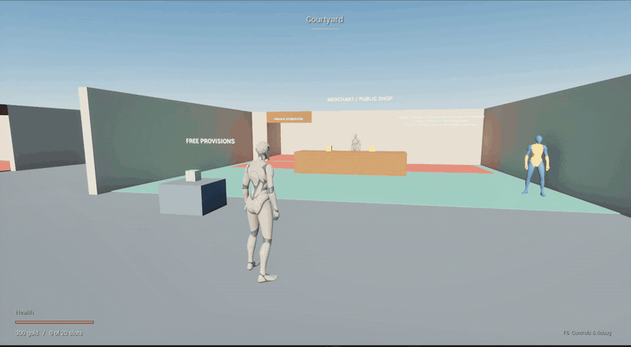
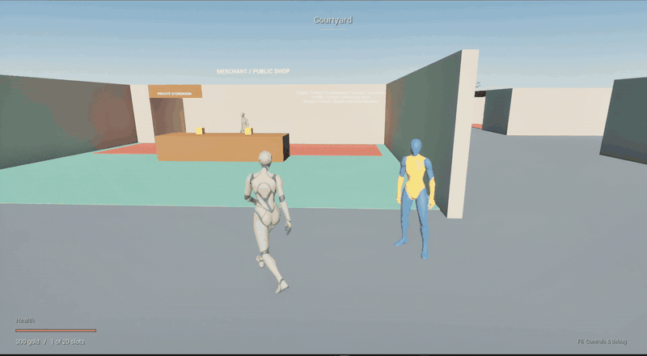
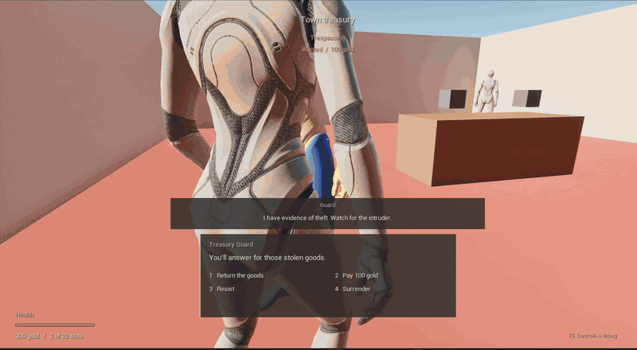
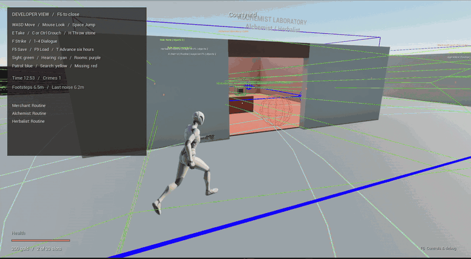
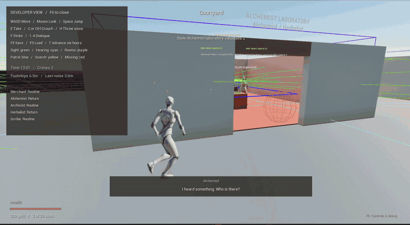
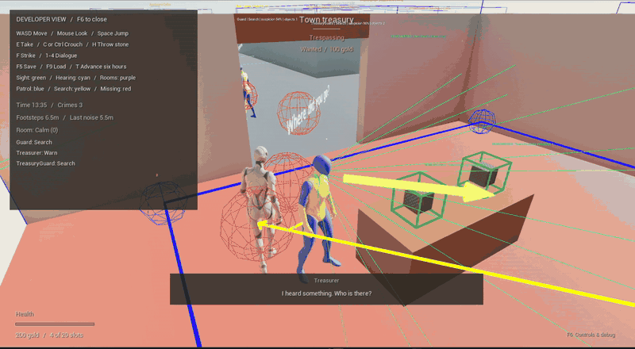
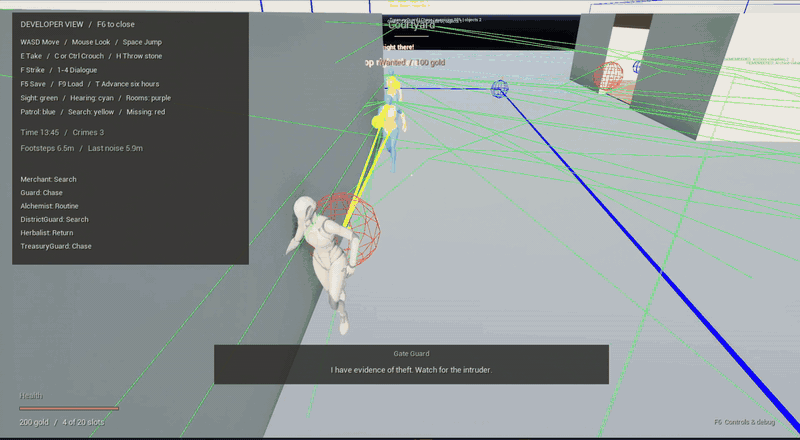

# The Watch Remembers

### NPC Ownership & Crime AI · Unreal Engine 5.8

A foundation for further development of an NPC ownership and crime system for RPGs. The prototype demonstrates room permissions, theft detection, missing-item discovery, guard communication, bounties, and pursuit using C++ and Blueprints.

This is an early systems prototype, not a finished gameplay experience. The current NPC reactions demonstrate the underlying rules and state transitions; they still need polish and fully implemented, game-specific responses, dialogue, and interactions. The placeholder environments and animations support testing that foundation.

## Code to Explore

- [APropertyAIController](Source/NPCproperty/Property/AI/PropertyAIController.cpp): Pursuit, last-seen-position searches, coordinated search roles, and confrontation handling. Start with `EvaluateAwareness`, `AdvanceResponse`, and `AssignSearch` to follow the AI decisions.
- [UPropertyLifeSubsystem](Source/NPCproperty/Property/PropertyLifeSubsystem.cpp): Report sharing with preserved witness identity, bounty management, and persistent world state. Start with `Communicate` to see how NPCs exchange evidence without granting a live reference to an unseen offender.

## Showcase

**Ownership and interaction:** unowned provisions can be taken freely. Items normally inherit the room owner's identity, with explicit ownership overrides available in the editor.

**Witnessed theft and bounty:** stealing in view triggers an alarm, a wanted status, and pursuit.

**Confrontation and settlement:** guards confront the player over stolen goods. Paying compensation clears the handled charges and transfers ownership of those items.

**Sound investigation:** NPCs investigate noise from a trespassing player in rooms they protect. Debug overlays expose hearing ranges, perception, and response states.

**Missing belongings and coordinated searches:** NPCs inspect remembered objects, discover their absence, and share reports. Responders divide inspection, exit watching, and nearby search duties.

**Group pursuit:** guards share crime reports and can pursue the same player independently. The recording shows two guards chasing together.

**Search and communication:** guard reports and search assignments remain visible in the developer view. Lost-sight searches use the player's last observed position.

## Programming Highlights

- **C++ systems:** room permissions, ownership inheritance, theft transactions, evidence provenance, hearing, pursuit, bounty settlement, and save/load.
- **Blueprints and StateTree:** editable response flow, context-dependent dialogue selection, movement-speed policies, noise-response cues, and presentation events. Animation Blueprints handle locomotion and crouching.
- **Designer tools:** room assignments, patrol schedules, response profiles, dialogue assets, viewport widgets, and runtime perception/search gizmos.

## Run the Project

Open [NPCproperty.uproject](NPCproperty.uproject) in Unreal Engine 5.8 and press Play. The town is the default map for both the editor and the game.

Use **E** to pick up items, **C / Left Ctrl** to crouch, **1–4** for confrontation choices, and **F6** for debug overlays.

[Back to the portfolio](../../README.md)
